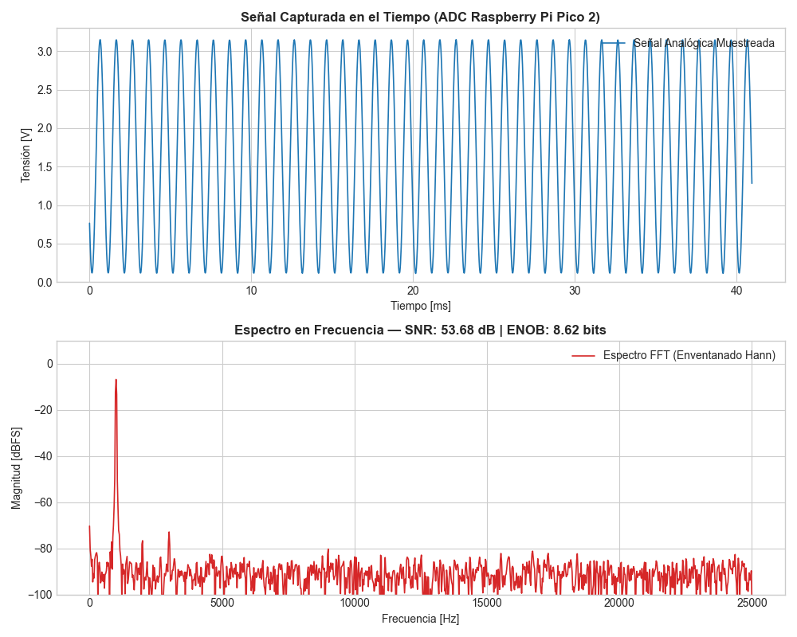

# Experiencia: Medición del ENOB en un ADC

## Introducción
Usaremos el ADC integrado en el kit de desarrollo Raspberry Pi Pico2 (RP2350) para medir la relación señal a ruido (SNR/SINAD) y con este dato calcular el número efectivo de bits (ENOB) de dicho ADC.

## Instrumental necesario
1. Kit de desarrollo Raspberry Pi Pico2
2. Generador de funciones
3. PC
4. Osciloscopio (opcional)

## Desarrollo de la práctica
### 1. Generación de la señal de entrada
Usando el generador de funciones, presetear la señal del primer ensayo: senoidal de 3,1 Vpp + Offset 1,65 V. Con esto nos aseguramos de que la tensión no supere el rango aceptado por el ADC (el micro se alimenta con 3.3 V). Chequear con el osciloscopio si es necesario.

### 2. Adquisición de datos en el microcontrolador
Conectar la Pico2 a la PC mediante cable USB.
Cargarle el programa provisto en este proyecto.
Conectar el generador de señales al ADC0, que se corresponde con el pin GPIO26. 
```
GEN(+) ---> GPIO_26
GEN(-) ---> GND
```
### 3. Cálculo en PC
Una vez conectado, correr el `script.py` en la PC.
Configurar el puerto serie correcto, según se le haya asignado a la Pico al conectar.
Este script espera la orden del micro de comenzar la captura, y recibirá los datos que este le envíe. Con ellos calculará la SNR y el ENOB; y mostrará los gráficos del espectro, aplicando una ventana de Hanning y la FFT.

   

## Informe del TP
### 1. Datos de la práctica y configuración 

_Complete con los datos utilizados durante el ensayo._

- Microcontrolador / Placa: Raspberry Pi Pico 2 (RP2350)
- Resolución Nominal del ADC ($N_{\text{bits}}$): 12 bits
- Tensión de Referencia ($V_{\text{REF}}$): $3.3\text{ V}$
- Frecuencia de Muestreo configurada ($f_s$): $50\text{ kHz}$
- Cantidad de muestras por ráfaga ($N$): $2048$
- Frecuencia de la señal de entrada ($f_{\text{in}}$): _______ $\text{Hz}$
- Amplitud pico a pico ($V_{pp}$) y Offset DC ajustados: _______ $V_{pp}$ / _______ $\text{V}$

### 2. Registro de resultados experimentales

Adjuntar las capturas de pantalla de los gráficos en tiempo y frecuencia generados por el script en Python para cada ensayo y completar la siguiente tabla: 

| Ensayo / Forma de Onda | Tensión Media (DC) [V] | Tensión Eficaz (Vrms) [V] | SNR / SINAD Medida [dB] | ENOB Calculado [bits] |
|:---------------------------------------------------|:---:|:---:|:---:|:---:|
| 1. Senoidal (Escala completa ~3.1 $V_{pp}$)        |     |     |     |     |
| 2. Senoidal (Amplitud reducida, ej. 1.0 $V_{pp}$)  |     |     |     |     |
| 3. Onda Triangular (Escala completa ~3.1 $V_{pp}$) |     |     |     |     |   

### 3. Cuestionario
_tentativo!!_

#### A. Resolución Física vs. Resolución Efectiva
- Compare el número de bits físicos del ADC (12 bits) con el ENOB obtenido en el Ensayo 1. ¿A qué fenómenos físicos y electrónicos atribuye la pérdida de resolución observada (ruido térmico, jitter de muestreo, ruido de la fuente de alimentación, ruido del generador)?

- Chequee el dato de ENOB dado por el fabricante y compárelo con el medido.

- Evaluación de desempeño: Con base en la SNR teórica ideal de un conversor de 12 bits ($\text{SNR}_{\text{ideal}} = 6.02 \cdot N + 1.76 \approx 74\text{ dB}$), ¿qué tan bueno diría que es el ADC del RP2350 para aplicaciones de instrumentación o audio? ¿Para qué tipo de aplicaciones resulta suficiente y cuándo requeriría un ADC externo?

#### B. Impacto del Rango Dinámico
- Compare el ENOB del Ensayo 1 (escala completa) con el del Ensayo 2 (amplitud reducida). Explique matemáticamente por qué desaprovechar el rango dinámico de entrada penaliza directamente la relación señal-a-ruido y reduce los bits efectivos del conversor.
- ¿Qué ocurriría en el espectro de frecuencias y en el cálculo del ENOB si aumentara la amplitud del generador por encima de los $3.3\text{ V}$ o por debajo de $0\text{ V}$ (recorte o clipping)?

#### C. Procesamiento Espectral y Enventanado
- ¿Por qué se aplica una ventana de Hann (o Hamming) a los datos muestreados antes de calcular la FFT? Explique qué ocurre en el dominio de la frecuencia si se omite este paso (fenómeno de fuga espectral o spectral leakage) cuando la frecuencia de la señal de entrada no es un múltiplo exacto de la resolución espectral ($\Delta f = f_s / N$).
- En el script de Python, la potencia de la señal fundamental ($P_{\text{signal}}$) no se toma de un único punto (bin) de la FFT, sino que se suma sobre una pequeña vecindad alrededor del pico máximo. ¿Por qué es necesario hacer esto al utilizar una ventana de Hann?

#### D. Naturaleza de la Señal de Prueba
- ¿Por qué la caracterización estándar del ENOB se realiza con una onda senoidal pura?Analice los resultados del Ensayo 3 (Onda Triangular): ¿Por qué el valor de ENOB calculado por el algoritmo cae drásticamente al ingresar una onda triangular, a pesar de que el ADC sigue siendo el mismo? Observe el gráfico del espectro en frecuencia y justifique qué representan los picos adicionales que aparecen sobre el piso de ruido.E. Arquitectura de Adquisición Embebida
- Sobre el firmware en C de la Pico 2: ¿Por qué se utilizó el controlador DMA sincronizado con la FIFO del ADC en lugar de leer las muestras mediante un bucle while con adc_read() y sleep_us() en el procesador principal? ¿Cómo afectaría el jitter (variación en el tiempo entre muestras) al piso de ruido de la FFT?

### 4. Conclusiones Finales
Redacte un párrafo de cierre resumiendo los aprendizajes principales de la práctica respecto a las limitaciones reales de los conversores A/D en sistemas embebidos y los cuidados necesarios al realizar análisis espectral.